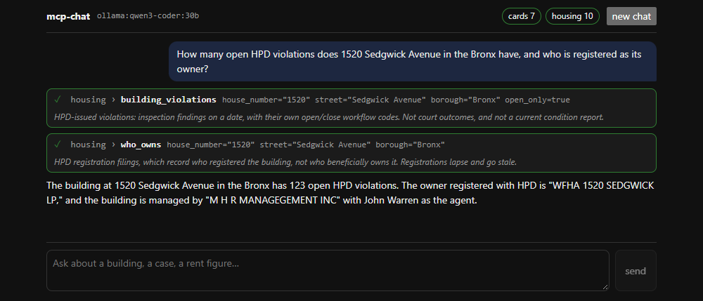

# mcp-chat

**A testbed, not a product.** I wrote this to drive my own MCP servers the way a model drives them: a small model, a real tool loop, every call and result on screen. A test suite exercises a server the way its author imagined; a model exercises it the way a reader does. If you want to chat with MCP servers, use a real client (Claude Desktop, Cursor, any MCP host). This exists to watch what happens between the model and the server, and it's kept small enough to read in one sitting.

What it found in its first week, in servers that already had passing suites and several review rounds behind them:

- `mcp-scryfall`: a card lookup returns one printing, and a model read that printing's set as where the card debuted. The server now says which printing it is, names the first printing, and carries every printing inline.
- `mcp-nychousing`: a model with no borough guessed one, got a correct zero, and reported "no match" for a building that exists. The server now names the borough(s) where the address is registered and, when there's exactly one, returns that borough's numbers inline.
- `mcp-nychousing` again: told "registered in BRONX, not BROOKLYN", the model narrated the Brooklyn zero as the Bronx answer. A model acts on a number in a tool result and skips an instruction in one. So the numbers are inline.

None of those are bugs a unit test would write. Each is a correct response read wrong by the thing that reads it.

**Reproduce the housing correction.** The [pinned regression tests](https://github.com/haksanlulz/mcp-nychousing/blob/b4e198c4e59317f932f6e1cd93d05881b6e2beef/test/server.test.ts#L705-L752) replay the Brooklyn lookup using synthetic NYC responses. They check the zero for Brooklyn, identify the Bronx registration, and verify the Bronx summary under the same open-violations filter. The [adapter change](https://github.com/haksanlulz/mcp-nychousing/commit/d8a07a20bc166fd1f57a51bb1070a203dce21a48) shows the implementation. The original model exchange is a historical observation; the screenshot below is a separate run with the borough supplied.

## What you can see

This is what makes it a testbed instead of a chat window. Press **debug** in the header:

- **thinking**: the model's reasoning, streamed as its own block above the calls it leads to, when the provider exposes it. Ollama: `MCP_CHAT_THINK=1` (probed once; a model without thinking, like `qwen3-coder`, is remembered and asked without it). Anthropic: `ANTHROPIC_THINKING_BUDGET=<tokens>`. Never merged into the answer.
- **turn strips**: one per model iteration. Expand a strip to inspect the conversation messages, tool names, timing and any token counts supplied by the provider. The provider formats its own wire request, including system instructions and full tool schemas, separately.
- **traces**: with `MCP_CHAT_TRACE=1` every request's frames go to `traces/<id>.jsonl` (gitignored, unredacted on purpose), the id comes back in an `x-mcp-chat-trace` header, and `GET /api/traces` / `GET /api/trace/:id` read them back. The turn footer links to the trace.

Measured on `qwen3.6:35b-a3b` with thinking on, one housing question: turn 1 was 8,077 tokens in (28 tool schemas) and 272 out in 2.1 s and ended in a tool call; turn 2 was 31,364 in (the 100-row violations result) and 487 out in 13.7 s. You can see what a verbose tool result costs instead of guessing.

What it is: a TypeScript runtime that spawns MCP servers over stdio, hands their tools to a model, runs the tool loop with every argument validated before any call, and streams tokens and tool calls over SSE to a React front end that renders each call as a card with its arguments, its result, and whether it failed. The server uses Node HTTP and SSE, the MCP SDK for stdio, and raw fetch for model providers.



*A real run: `qwen3-coder:30b` on a local GPU, two MCP servers over stdio (`mcp-nychousing`, `mcp-scryfall`). The italic line under each card is the server's own `record_scope`, which says what the data does and doesn't establish. `node tools/screenshot.mjs` retakes this against whatever you have running.*

## Run

```
npm ci                    # Node 22.12+ on the 22.x line, or supported Node 24/26+
cp mcp-chat.config.example.json mcp-chat.config.json   # edit the servers list
npm run dev:server        # runtime on http://127.0.0.1:8731
npm run dev:web           # UI on http://127.0.0.1:5173, proxies /api to the runtime
```

Or build the UI once and let the runtime serve it: `npm run build:web`, then the runtime's own `http://127.0.0.1:8731/`. That page gets a fresh CSP nonce per load with `strict-dynamic`, and Trusted Types with no policy allowed, so no HTML string can reach a DOM sink. The Vite dev page does not get either, because its hot reload needs inline script. `MCP_CHAT_WEB_DIR` overrides `dist/web`.

Model selection, by environment, first match wins:

| env | provider |
|---|---|
| `OPENAI_BASE_URL` set | any **OpenAI-compatible** `/chat/completions` server: OpenRouter, LM Studio, llama.cpp `llama-server`, vLLM, LiteLLM, Ollama's own `/v1`. `OPENAI_MODEL`, `OPENAI_API_KEY` (omit for local servers) |
| `ANTHROPIC_API_KEY` set | Anthropic Messages API; `ANTHROPIC_MODEL` (default `claude-sonnet-5`) |
| otherwise | Ollama's native API at `OLLAMA_BASE_URL` (default `http://127.0.0.1:11434`); `OLLAMA_MODEL` (default `qwen3-coder:30b`) |

So any model, as long as it sits behind one of those three wires and can call tools. A model without tool calling in its template gets the tools and can't use them; it'll just chat. The Ollama-native provider exists for its `think` field and per-frame timing. The same Ollama model over `OPENAI_BASE_URL=http://127.0.0.1:11434/v1` gave the same answer to the same question (123 open violations at 1520 Sedgwick, 16 A / 35 B / 72 C), which is the check that the two wires agree.

`MCP_CHAT_PORT` (8731) and `MCP_CHAT_CONFIG` (path) override the defaults. The runtime binds 127.0.0.1, checks the request host and browser origin, and accepts JSON chat bodies up to 8 MiB. Stop cancels pending local work and asks the provider or MCP server to cancel ongoing work; external work already performed cannot be rolled back.

## Config

```json
{
  "system": "optional system prompt",
  "maxIterations": 8,
  "servers": [
    { "name": "housing", "command": "npx", "args": ["-y", "@haksanlulz/mcp-nychousing@1.1.1"], "readOnly": true },
    { "name": "cards",   "command": "npx", "args": ["tsx", "/path/to/mcp-scryfall/index.ts"], "cwd": "/path/to/mcp-scryfall" }
  ]
}
```

**Only read-only tools run.** Nothing here asks you before a tool call, so a call runs only when the tool declares `annotations.readOnlyHint: true`, or its server has `"readOnly": true` in this file (you vouch that every tool on it only reads). Any other call is refused before the server sees it, and the model is told why.

Each server's tools are exposed to the model as `<name>__<tool>`, so two servers can both have a `search`. A server that fails to start is reported on `/api/health` and in the UI's header; the assistant runs with whatever came up. The child process gets `PATH` and the platform basics plus the `env` you give it, and nothing else from the shell.

## HTTP

| route | |
|---|---|
| `GET /api/health` | `{ ok, model, servers: [{ name, state: up\|failed, tools, error? }] }` |
| `GET /api/tools` | the qualified tool list the model sees |
| `POST /api/chat` | `{ messages: [{ role, content }] }` → `text/event-stream` of frames below; `x-mcp-chat-trace` header when tracing is on |
| `GET /api/traces` | recent traces (id, model, question) |
| `GET /api/trace/:id` | one trace's frames |
| `GET /`, `GET /assets/*` | the built UI (`dist/web`) with a nonce CSP and Trusted Types; 404 until `npm run build:web` |

Frames, in order per iteration: `thinking` · `token` · `tool_call` · `turn` (iteration, the messages and tools sent, usage, how it ended) · `tool_result` (with `isError`) · `error` · `done` (`stoppedBy: answer | cap | error`). `done` is emitted exactly once, last.

## Testing

```
npm test          # offline loop, provider, MCP and UI tests
npm run typecheck
npm run smoke     # starts the real runtime against a fixture MCP server, hits every route, stops it by PID
```

| file | what it pins | channel |
|---|---|---|
| `test/agent.test.ts` | the loop's rules below; `thinking` never a token; a `turn` frame per iteration carrying what was sent | scripted model, in-process |
| `test/openai.test.ts` | the OpenAI-compatible wire: tool-call fragments assembled by index, `reasoning_content` as thinking, usage via `stream_options`, `[DONE]`, transcript mapping with `tool_call_id`, malformed args handed to the validator | `fetch` stubbed with chunked streams |
| `test/providers.test.ts` | Ollama NDJSON + Anthropic SSE parsing, transcript mapping, error frames, non-2xx; thinking on both providers, the Ollama think probe, usage/timing | `fetch` stubbed with chunked streams |
| `test/mcp.test.ts` | server start/fail isolation, qualified names, `isError` pass-through | a **real MCP server over stdio** (`test/fixtures/echo-server.ts`) |
| `test/api.test.ts` | `/api/chat` body: roles, caps, extra keys | pure |
| `test/web.test.tsx` | error card, cap note, no result-as-text, SSE reassembly, bold; debug view: thinking block, turn strips, prompt disclosure | `react-dom/server`, no browser |
| `test/markdown.test.tsx` | the markdown subset: headings, nested lists, bold/italic nesting, code, links + bare-URL autolink, no HTML path, `javascript:` refused | `react-dom/server`, no browser |

Every RED LEG test was shown to fail when its rule was removed before it was trusted (mutation-probed 2026-09-15, 09-18, 09-19, 09-20 ×2). CI targets Node 22.12 and 24.

## Rules the loop enforces

Each has a test in `test/agent.test.ts`. The UI's own rules live in `test/web.test.tsx`; the providers' in `test/providers.test.ts`; the manager's in `test/mcp.test.ts`.

1. **Arguments are validated against the tool's `inputSchema` before any call**: missing required key, unknown key (with a near-miss suggestion), wrong type, and nested constraints. Draft 2020-12 (the default), 2019-09, draft-07 and draft-04 are supported; keywords the dialect does not define (vendor `x-` hints, OpenAPI `nullable`) are ignored as JSON Schema specifies; other dialects, external references and async schemas fail closed. For simple top-level schemas with no `additionalProperties`, the typo guard intentionally rejects unknown keys even though JSON Schema normally permits them. Set `additionalProperties: true` to permit them, or specify an appropriate schema. Composed and pattern-property schemas use their schema rules. A bad call becomes an `isError` result the model can read, and the tool is never invoked.
2. **A tool error is surfaced as an error frame and fed back. It never becomes text.** The UI renders it as a failed card with "this is not an answer". A thrown tool becomes an `isError` result instead of a crash.
3. **The iteration cap is loud.** Hitting it emits an `error` frame and `done(cap)`. Nothing is truncated quietly.
4. **Unknown tool names are refused before any call.**
5. **The client sends user and assistant turns only.** `POST /api/chat` refuses `tool` and `system` roles, non-string content, a transcript that doesn't end on the user, more than 200 messages or 32K characters per message. Tool results exist only inside one request, built by the loop, so a client can't forge one.
6. **A failed call is a failed card, never answer text** (`web/`). The transcript keeps tool results inside cards. The only text a reader sees as the answer is what the model streamed as tokens.
7. **Thinking is never an answer.** A provider's reasoning arrives as `thinking` frames, is kept as its own part, and is shown only under debug. Anthropic extended-thinking tool turns retain ordered signed and redacted blocks privately for continuation in the same request. Signatures and redacted payloads are not emitted to the UI or traces.
8. **Model text is rendered as markdown, to React elements only** (`web/src/markdown.tsx`): headings, nested bullet and numbered lists, paragraphs, `**bold**`, `*italic*` / `_italic_` (nesting either way; a `*` or `_` inside a word stays text), inline and fenced code, and links, both `[text](http…)` and bare `http(s)://` URLs, opened in a new tab with `rel="noopener noreferrer"`. No raw HTML ever reaches the page; every string becomes a text node. A `javascript:` link keeps its text and gets no anchor, and the `[tool_name](link)` pseudo-links models write for tools they mean render as code. No dependency; the subset is what models emit in practice.

## Measured

2026-09-15, this machine (AMD 7900 XTX, Ollama on ROCm):

- `npm test`: 12/12 on 09-15, 42/42 on 09-19; `npm run typecheck` clean; `vite build` 228 KB JS.
- Runtime over a real server (`mcp-scryfall` via `tsx` over stdio): `/api/health` up with 7 tools, `/api/tools` lists them qualified, malformed `POST /api/chat` → 400.
- **Full loop, local model:** `qwen3-coder:30b` was asked for Lightning Bolt's text and cost. It called `cards__card_named {"name":"Lightning Bolt"}`, the server answered, and the model wrote one sentence quoting the real Oracle text and `{R}`. 2 iterations, `stoppedBy: answer`, 27 tokens.
- **2026-09-18, screenshot above:** `npm test` 21/21 (12 loop + 9 web), typecheck clean. Two servers up (`housing` 10 tools, `cards` 7). Asked for 1520 Sedgwick Avenue's open HPD violations and registered owner: the model called `building_violations` then `who_owns`, using the Bronx borough supplied in the screenshot question, and answered 123 open with the registered owner and managing agent. Those figures come from the server. An earlier take of the same question broke the count down by class (16 A / 35 B / 72 C); the wording varies between runs and the numbers hold.
- **In the browser, two turns (2026-09-15):** asked about Lightning Bolt and a misspelled "Lightning Bolp". The model called `card_named` for the first and chose `card_fuzzy` for the typo, both cards rendered green with server › tool and the arguments, and the answer quoted `{R}` / 3 damage and called the second a typo. A follow-up ("mana cost of Counterspell") called `card_named` again and answered `{U}{U}`. Enter-to-send verified with a dispatched `keydown` (the harness's synthetic Return key didn't reach React; a real keyboard does).

## Not yet, and not planned

This is a harness. It has what watching a server needs and nothing a product would.

- Tool history isn't round-tripped across requests; each `POST /api/chat` sends the human-readable transcript only.
- No auth, no TLS, no remote MCP transports, no accounts, no persistence beyond the trace files. Local tool, local model, local servers, one tab.
- Traces are unredacted on purpose and aren't rotated. Delete `traces/` when it gets big.
